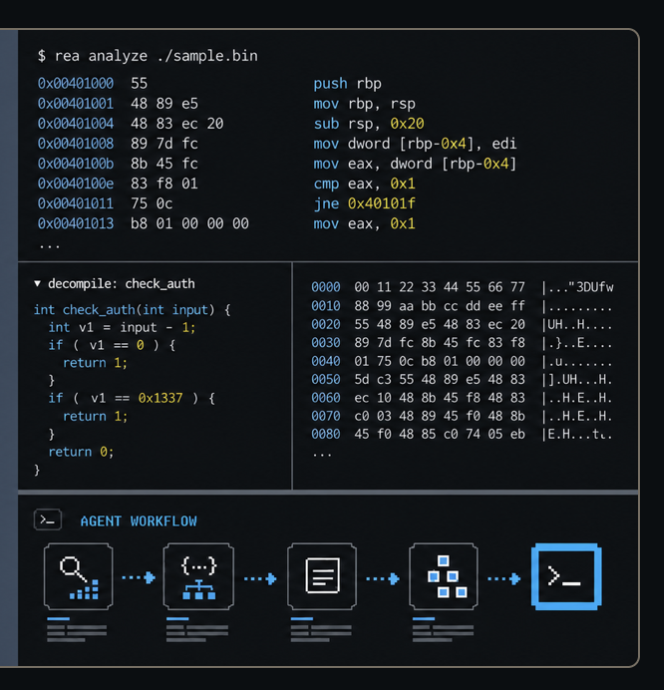

# Generate Social Preview

A Codex skill for creating social preview images grounded in what a repository
actually does. It reads the project, shapes concise copy, chooses a visual
direction, and produces a card that stays readable at thumbnail size.

Use it for GitHub repository previews, package pages, launch posts, and link
cards. It supports new images, revisions, palette variants, and adapting a
supplied style reference.

## Install

Clone this repository into your Codex skills directory:

```bash
git clone https://github.com/morluto/generate-social-preview.git \
  "${CODEX_HOME:-$HOME/.codex}/skills/generate-social-preview"
```

If the skill is already installed, review or back up that directory before
replacing it. Restart Codex after installation to load the skill.

The skill uses the `imagegen` skill for raster generation and editing. Image
generation must be available in your Codex environment. The optional
normalization helper needs Bash and either macOS `sips` or ImageMagick's
`magick` command.

## Use

Open the repository you want to feature and ask Codex:

```text
Use $generate-social-preview to create a GitHub social preview for this repository.
```

You can provide a direction or constrain a revision:

```text
Use $generate-social-preview with a Swiss technical direction and a warm paper palette.
```

```text
Use $generate-social-preview to revise this card. Change only the tagline;
keep the product name, palette, and illustration unchanged.
```

By default, the skill produces one candidate, checks the copy and composition,
and saves a versioned image without overwriting an existing asset. GitHub
previews are normalized to a 1280×640 PNG after visual inspection.

## Visual directions

The bundled [style guide](references/style-directions.md) covers retro
editorial, Swiss technical, terminal collage, evidence workflow, and
diagrammatic print directions. Choose the medium that makes the product's
actual workflow or artifacts easiest to recognize.

These images are **style references**, not templates to reproduce:

| Retro editorial | Evidence workflow |
| --- | --- |
|  |  |

## Normalize an existing image

```bash
bash "${CODEX_HOME:-$HOME/.codex}/skills/generate-social-preview/scripts/normalize-preview.sh" \
  candidate.png social-preview-v1.png
```

The helper accepts an approximately 2:1 source, writes a 1280×640 PNG, and
refuses to overwrite an existing output. It does not generate images or check
their visual quality.

## Repository contents

- [SKILL.md](SKILL.md) — workflow, copy guidance, and visual checks.
- [agents/openai.yaml](agents/openai.yaml) — Codex display metadata.
- [references/style-directions.md](references/style-directions.md) — art direction guidance.
- `assets/style-references/` — labeled visual references.
- [scripts/normalize-preview.sh](scripts/normalize-preview.sh) — image normalization helper.
